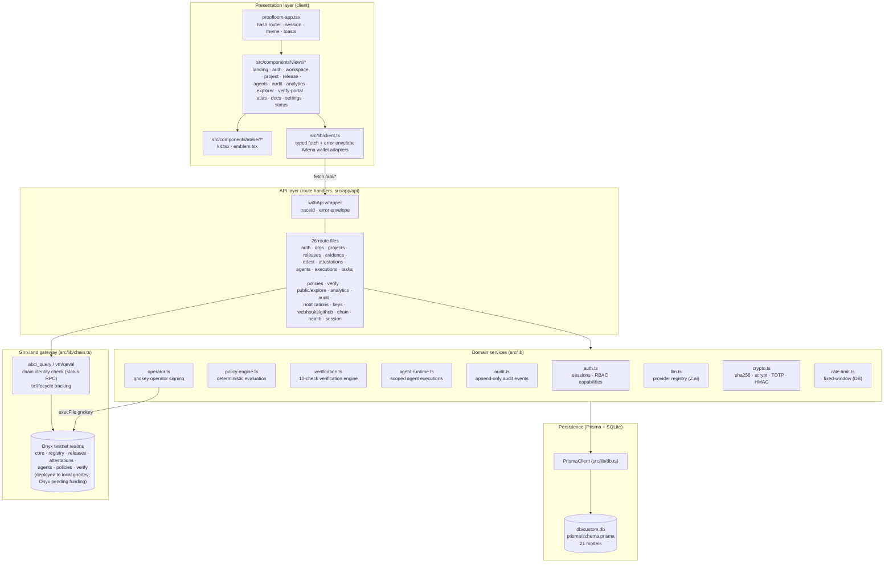

# PROOFLOOM — System Architecture

This document describes the system **as implemented** in this repository. Every layer, module and
flow referenced below exists in the source tree; planned pieces are marked **Planned**.

---

## 1. Layered overview

PROOFLOOM is a single Next.js 16 application (App Router, `src/app`) that embeds its own API tier,
domain services and persistence, and talks to an external Gno.land chain through a read/track
gateway. There is no separate backend process, message broker or worker fleet.

**Data flow rule of thumb:** every HTTP request enters through a route handler wrapped in
`withApi`; the handler resolves an auth context (`src/lib/auth.ts`), enforces tenant/RBAC checks,
delegates to a domain service or Prisma directly, writes an audit event for privileged actions,
and returns either `{ data }` or `{ error: { code, message, recovery, … } }` plus an `X-Trace-Id`
header.

## 2. Request pipeline

`src/lib/api.ts` defines the uniform pipeline used by every route:

- **`withApi(fn)`** — generates a trace id (`Math.random().toString(16).slice(2) + Date.now().toString(16)`),
  runs the handler, wraps the return value as `{ data }`, sets `X-Trace-Id` on both success and
  error responses, and converts thrown `ProofloomError`s into the error envelope. Unknown
  exceptions become `INTERNAL` (HTTP 500) with the original message logged server-side only.
- **`ok(data)` / `fail(e, traceId)`** — the two response shapes. The error object carries
  `code`, `message`, `recovery`, optional `details`, and the trace id at the top level.
- **`readJson<T>(req)`** — JSON body parsing that throws `VALIDATION_FAILED` on malformed bodies.
- **`requireFields(body, fields)`** — missing-field validation helper.
- **`guardRate(name, identifier, limit, windowMs)`** — calls `src/lib/rate-limit.ts` and throws
  `RATE_LIMITED` (429, with `resetAt`) when the bucket is exhausted.
- **`clientIp(req)`** — leftmost `x-forwarded-for` entry, fallback `'local'`.
- **`requireAuthShim()`** — non-throwing variant of `getAuth()` used by routes that branch on
  anonymous vs authenticated access (e.g. `/api/session`, `/api/orgs`).

Rate limiting (`src/lib/rate-limit.ts`) is a **fixed-window counter persisted in the `UsageRecord`
table** via atomic upsert on `(key, window)` — single-node safe, no Redis. Standard buckets:
`auth` (50/5 min global), `login-ip` (30/5 min), `login-fail` (10/15 min per email),
`verify` (120/min per IP), `public-explore` (240/min per IP), `api` (600/min per org),
`agent-exec` (30/min per org), `register` (10/h per IP).

## 3. Authentication and authorization model

- **Sessions** (`src/lib/auth.ts`): opaque 256-bit tokens; only the sha256 hash is stored
  (`Session.tokenHash`); cookie `pl_session` is `httpOnly`, `sameSite=lax`, `secure`, 30-day expiry.
  `requireAuth()` auto-rotates sessions older than 7 days. Revocation records a reason.
- **MFA**: optional TOTP (RFC 6238, base32 secret, 6 digits, ±1 step tolerance). `checkMfa()` gates
  login and MFA-enable/disable.
- **RBAC** (`src/lib/auth.ts`): eight roles ranked `VIEWER(10) … AGENT_OPERATOR(25), AUDITOR(30),
  ENGINEERING_LEAD(40), SECURITY_ADMIN(50), ADMIN(60), OWNER(100)`, each mapped to a capability
  list (`org.manage`, `project.create`, `release.publish`, `attestation.issue`, `agent.grant`,
  `policy.write`, `audit.read`, `apikeys.manage`, …). Enforcement helpers:
  - `requireMembership(userId, organizationId, capability)` → `NOT_A_MEMBER` / `FORBIDDEN`
  - `requireProjectAccess(userId, projectId, capability)` → loads the project and checks the
    parent org membership (this is how **tenant isolation** is enforced for project-scoped data)
  - Direct tenant checks in agents/executions routes throw `TENANT_ISOLATION` when the record's
    `organizationId` differs from the caller's.
- **Password hashing**: scrypt (N=16384, r=8, p=1, 64-byte key, salted, constant-time compare).

## 4. Audit logging

`src/lib/audit.ts` exposes a single `audit(input)` function that appends an `AuditEvent` row
(org/project/actor ids + optional gno address, `action`, `targetType`/`targetId`, JSON `metadata`,
`ip`, `traceId`). Rules enforced by convention and by the API:

- Every mutating route writes an audit event as a side effect of the privileged action
  (`project.create`, `release.publish`, `attestation.issue`, `agent.grant`, `chain.publish_release`,
  `auth.login`, …).
- There is **no update or delete path** for audit rows; `POST /api/audit` deliberately returns
  `FORBIDDEN` ("audit events are append-only and platform-written").
- The GitHub webhook route writes `github.<event>` audit rows even when no organization mapping
  exists (with `organizationId: null`), so deliveries are never silently dropped.

## 5. Chain gateway design

`src/lib/chain.ts` is the single seam between the platform and Gno.land:

- **Transport**: JSON-RPC `POST` to the configured RPC endpoint (`activeChain()`), method
  `abci_query` with `{ path: 'vm/qeval', data: base64(expression), height: '0', prove: false }`.
  12-second `AbortController` timeout; `cache: 'no-store'`.
- **Error mapping**: RPC errors and missing `ResponseBase` → `CHAIN_UNAVAILABLE` (503). Realm
  panics whose logs match `unknown release|project|agent|attestation|component|execution|grant` or
  package errors → `NOT_FOUND` (404); other realm errors → `TX_FAILED` (502).
- **Chain identity check**: `verifyChainIdentity()` calls the `status` RPC (`params: [null]`),
  compares `node_info.network` against the configured chain id and throws `CHAIN_ID_MISMATCH` on
  mismatch. Result cached for 60 s with latest block height. Every realm evaluation calls it first.
- **Realm queries** (read-only): `realmEval(pkg, expression)` evaluates
  `{realmPrefix}/{pkg}.{expr}`; helpers wrap the deployed contracts:
  - `fetchOnChainVerdict(releaseId)` → `verify.VerifyRelease("id")`, parsed from the Go-struct
    rendering (`parseGoStruct` handles flat string fields only — nested attestation arrays in the
    verdict are not parsed by the platform today).
  - `fetchReleaseStatus(id)` → `releases.ReleaseStatus("id")`
  - `fetchRegistryStats()` → `verify.RegistryStats()` (projects/components/releases/attestations)
  - `fetchOnChainProject(slug)` → `registry.GetPublicProject("slug")`
- **Transaction lifecycle**: the `ChainTransaction` table records the ten states
  `CREATED → SIMULATED → AWAITING_SIGNATURE → SIGNED → BROADCAST → PENDING → CONFIRMED | FAILED |
  EXPIRED | RECONCILIATION_REQUIRED`. `reconcileTransaction(txHash, confirmExpr)` performs
  **state-based confirmation**: it re-evaluates the realm expression that must succeed once the tx
  landed and returns `CONFIRMED | PENDING | FAILED`. A hash alone is never trusted.
- **Key handling**: the gateway never holds user keys. Wallet operations are signed client-side
  (Adena `signAmino`/`signEcdsa`/`sendTransaction` in `src/lib/client.ts`); the platform only
  records lifecycle transitions (`POST /api/chain op=record|transition`).

## 6. Operator signing flow

`src/lib/operator.ts` implements the second signing path for platform-operated (demo/testnet
integration) transactions:

1. Activation requires `PROOFLOOM_OPERATOR_MNEMONIC` in the environment
   (`operatorAvailable()`); without it, every operation throws `FAUCET_DEPLETED` with an explicit
   recovery message — no simulated success.
2. `withKeybase()` creates a **temporary keybase directory** (`mkdtempSync`), recovers the key via
   `gnokey add … --recover --insecure-password-stdin` (mnemonic piped via stdin), runs the
   operation, then deletes the keybase (`rmSync`) in a `finally` block.
3. `operatorBroadcastCall({ pkgpath, func, args, gasWanted, gasFee, memo })` builds a
   `gnokey maketx call … --broadcast sync` command (defaults: gas fee `5000000ugnot`, gas wanted
   `2 500 000`, 60 s timeout) and extracts the tx hash from combined stdout/stderr.
4. `operatorDeployPackage()` performs `maketx addpkg` deployments for the realm pipeline.
5. Callers in `POST /api/chain` (`op=publish-on-chain`, `op=attest-on-chain`) then record a
   `ChainTransaction` row (status `BROADCAST`) and audit the action with `signing: 'operator'`;
   `op=confirm-on-chain` reconciles via the state-based check and, on confirmation, stamps the
   release `gnoRegistered`/`onChainRef`.

The `gnokey` binary is resolved via `PROOFLOOM_GNOKEY_BIN` (default
`/home/z/my-project/bin/gnokey`, shipped in-repo under `bin/`).

## 7. Verification flow

`src/lib/verification.ts` implements the engine behind `GET /api/verify/...`:

- **`verifyAttestation(protocolId)`** — ten sequential checks, each reported with
  `{requirement, passed, detail}`: `record_exists`, `signature_valid`, `issuer_identity`,
  `issuer_authorized` (issuer is a member of the owning org, or the recorded operator address),
  `digest_integrity` (re-computes sha256 from inline evidence bytes), `not_expired`,
  `not_revoked`, `chain_publication` (live realm query for release subjects), `evidence_accessible`,
  `completeness` (active policy categories present). Verdict composition: hard negatives win
  (`REVOKED` > `EXPIRED` > `FAILED`) otherwise any failed check yields `PENDING`, else `VERIFIED`.
  Each run persists a `VerificationResult` row.
- **`verifyRelease(idOrProtocolId)`** — resolves platform id or `{project-slug}-{version}`; checks
  `record_exists`, `published` (public states only), `artifact_digest`, `attestations_active`,
  `policy_satisfied` (deterministic re-evaluation), `chain_publication` (on-chain digest must match
  the platform record — a mismatch produces verdict `FAILED`). Result persisted with requester IP.
- **`verifyDigest(digest)`** — returns published releases committing to the digest.
- Every report includes a `limitations[]` array ("a valid signature proves origin and integrity,
  not that the underlying artifact is safe"; "on-chain commitments are content digests only").

## 8. Agent runtime flow

`src/lib/agent-runtime.ts` (off-chain):

1. `startExecution` — validates agent status and tenant, rate-limits per org (`agent-exec`),
   resolves the optional task, and enforces the grant gate: an active `AgentGrant` on the target
   project with `EVIDENCE` or `TASK_UPDATE` scope (mirroring the on-chain rule). Creates the
   `AgentExecution` row (`RUNNING`), audits `agent.execution.start`, then launches the run without
   blocking the response.
2. `runExecution` — assembles sanitized context (agent, project, recent releases, policy, task),
   calls the LLM registry under a strict system prompt ("respond with ONLY a JSON object …; never
   invent test results, digests, or transaction data"), validates output via
   `validateAgentReport`, and stores the report with its sha256 `reportDigest`. Executions whose
   conclusion would matter (`PASS`/`FAIL` on a project) stop in `AWAITING_APPROVAL`.
3. `approveExecution` — human-only transition to `COMPLETED`/`REJECTED`, audited.
4. `attestExecution` — binds the report digest as an `AGENT_TASK_COMPLETION` attestation with a
   deterministic protocol id `{executionId}-agent_task_completion-{issuerAddress}`.

Failure honesty: provider unavailability marks the execution `FAILED` with
`LLM_PROVIDER_UNAVAILABLE`; invalid model output marks it `LLM_OUTPUT_INVALID`.

## 9. Cross-cutting decisions

- **Single-process, single-node**: SQLite file DB, in-process fire-and-forget agent runs, DB-backed
  rate limiting. Horizontal scale-out and durable queues are **Planned**.
- **Honesty over simulation**: missing credentials/chain/providers surface explicit error codes
  (`FAUCET_DEPLETED`, `CHAIN_UNAVAILABLE`, `LLM_PROVIDER_UNAVAILABLE`, `GITHUB_UNAUTHORIZED`)
  rather than fake success; analytics endpoints label their data sources.
- **No silent data loss**: webhook deliveries are stored even without org mapping; invite URLs are
  returned to the UI instead of pretending email was sent.
- **Traceability**: trace ids are generated per request and persisted on audit events where
  provided by the route.

## 10. Repository layout (top level)

| Path | Role |
| --- | --- |
| `src/app/api/**` | 26 route handlers (Next.js App Router, all `dynamic = 'force-dynamic'`) |
| `src/lib/*.ts` | domain services & infrastructure (auth, api, chain, operator, verification, policy-engine, agent-runtime, llm, audit, crypto, rate-limit, errors, db, client, categories) |
| `src/components/views/*` | 14 product surfaces (hash-routed SPA) |
| `src/components/atelier/*` | design-system kit + emblem/glyph vocabulary |
| `src/components/ui/*` | shadcn/ui primitives (only 8 are imported by views: button, input, label, textarea, dialog, select, tabs, dropdown-menu) |
| `prisma/schema.prisma` | 21-model data model (SQLite) |
| `chain/realms/proofloom/*` | 7 Gno realm packages + tests |
| `chain/scripts/deploy.sh` | realm deployment pipeline (writes `chain/deployments/deployment-<network>.json`) |
| `bin/gnokey`, `bin/gno` | vendored Gno toolchain used by the operator flow |
| `db/custom.db` | SQLite database file (`DATABASE_URL=file:/home/z/my-project/db/custom.db`) |
